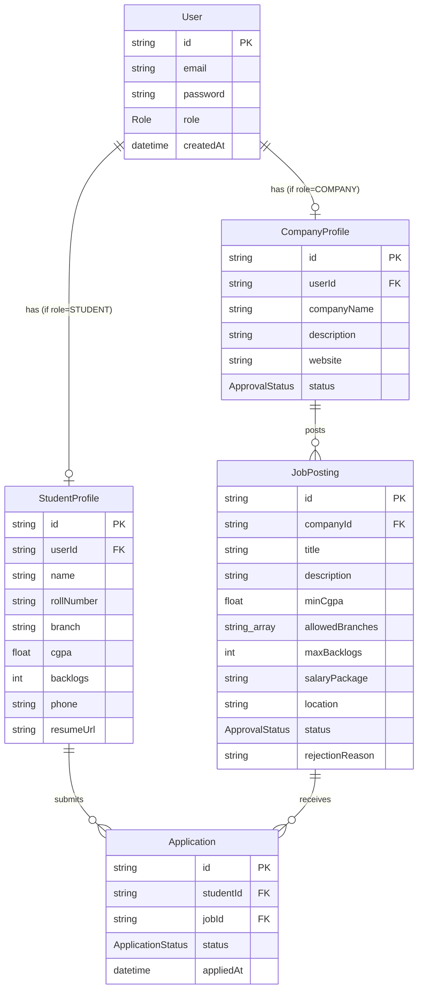

# Entity-Relationship Diagram

Mirrors [`src/db/schema.ts`](../src/db/schema.ts) (Drizzle ORM). Renders automatically on GitHub.

## Enums

| Enum | Values |
|---|---|
| `Role` | `STUDENT`, `COMPANY`, `ADMIN` |
| `ApprovalStatus` | `PENDING`, `APPROVED`, `REJECTED` — used by both `CompanyProfile.status` and `JobPosting.status` |
| `ApplicationStatus` | `APPLIED`, `SHORTLISTED`, `REJECTED`, `HIRED` |

## Notes

- `ADMIN` users have no profile row — they're identified by `User.role` alone, and seeded directly (no self-registration).
- `Application` has a unique constraint on `(studentId, jobId)` — a student can apply to a given job only once.
- `JobPosting.allowedBranches` is a plain string array of eligible branches; `minCgpa`/`maxBacklogs` are advisory criteria shown to students, **not** enforced at apply-time (per MVP scope — see plan).
- A `JobPosting` only becomes visible to students once `status = APPROVED`, set by an Admin. Same approval gate applies to `CompanyProfile` before a company can post jobs.
