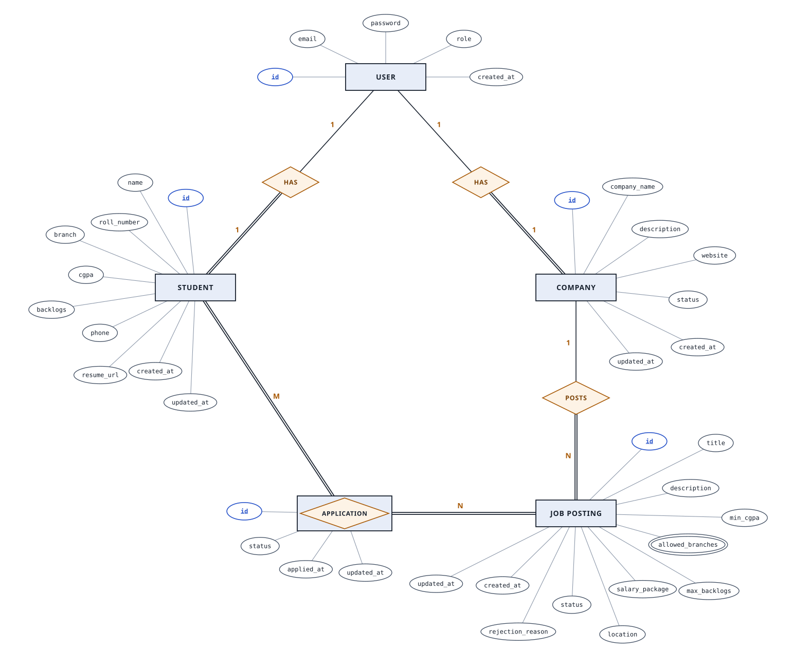
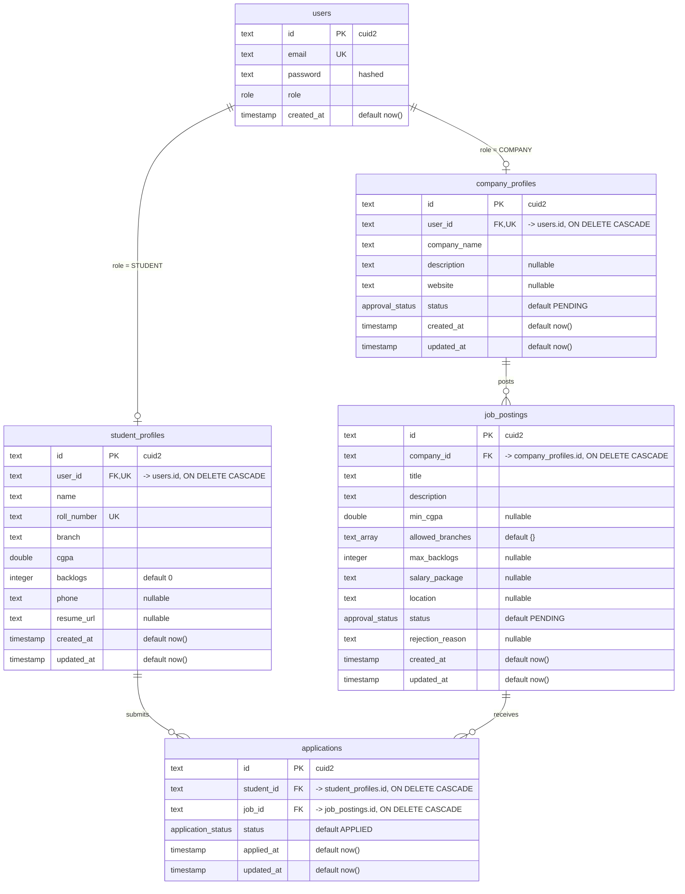

# Entity-Relationship Diagram

Mirrors [`db/schema.ts`](../db/schema.ts) (Drizzle ORM, PostgreSQL). Entity names are the real table names. Renders automatically on GitHub.

## Chen notation

Rectangles are entities, ovals are attributes, diamonds are relationships, an underlined attribute is the primary key, a double oval is multivalued (an array), and a double line means total participation. `applications` is an associative entity (the M:N table between students and jobs). Foreign-key columns are not drawn as ovals because the relationship lines stand in for them.

## Crow's-foot notation (full column list)

## Enums

| Postgres enum | Values | Used by |
|---|---|---|
| `role` | `STUDENT`, `COMPANY`, `ADMIN` | `users.role` |
| `approval_status` | `PENDING`, `APPROVED`, `REJECTED` | `company_profiles.status`, `job_postings.status` |
| `application_status` | `APPLIED`, `SHORTLISTED`, `REJECTED`, `HIRED` | `applications.status` |

## Keys and constraints

| Table | Constraint |
|---|---|
| `users` | `email` unique |
| `student_profiles` | `user_id` unique (one profile per user), `roll_number` unique |
| `company_profiles` | `user_id` unique (one profile per user) |
| `applications` | unique index `applications_student_job_idx` on `(student_id, job_id)`, so a student can apply to a given job only once |

All columns are `NOT NULL` unless marked nullable above. Primary keys are `text` cuid2 values generated in the app (`createId()`), not by the database.

## Delete behaviour

Every foreign key is `ON DELETE CASCADE`, so deletes travel down the chain:

- Deleting a **user** deletes their student or company profile.
- Deleting a **company profile** deletes all of its job postings, and with them every application to those jobs.
- Deleting a **student profile** deletes all of that student's applications.

## Notes

- `ADMIN` users have no profile row. They're identified by `users.role` alone and seeded directly (no self-registration).
- The database does not tie the profile type to `users.role`. The app has to make sure a `STUDENT` user only gets a `student_profiles` row and a `COMPANY` user only gets a `company_profiles` row.
- `job_postings.allowed_branches` is a plain `text[]` of eligible branches. `min_cgpa` and `max_backlogs` are advisory criteria shown to students and are **not** enforced when a student applies (MVP scope).
- A job posting is visible to students only once its `status = APPROVED`, set by an Admin. The same approval gate applies to `company_profiles` before a company can post jobs.
- `updated_at` defaults to `now()` on insert only. Drizzle does not update it automatically, so update queries must set it.
